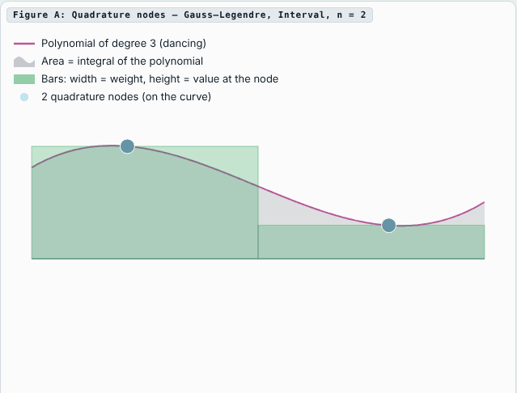

# Cubature Atlas

[](https://doi.org/10.5281/zenodo.24037245)

**Best known quadrature and cubature rules with few points and positive weights** on the interval, triangle, square, tetrahedron and cube, degrees 1 to 30, with certificates and source code.

Website: <https://jukzi.github.io/cubature_atlas/>

<p align="center">
  <a href="https://jukzi.github.io/cubature_atlas/"></a>
  <br>
  <sub>Figure A of the website (default view): the 2-point Gauss–Legendre rule integrates every polynomial of degree 3 exactly. The bars (width = weight, height = value at the node) always enclose the same area as the curve.</sub>
</p>

> **AI-generated.** The search, the computations, the certificates, the code and the texts were produced by an AI (Claude, Anthropic), commissioned and directed by Dr. rer. nat. Jörg Kubitz (Dipl.-Math.). Every rule is checked automatically by `tools/build_atlas.py` (all monomial moments, in floating point). The rules of the atlas's own search also carry a Newton–Kantorovich certificate, computed in floating point with an estimated Lipschitz constant, so it is strong evidence but not a proof. `tools/verify_rigorous.py` adds a rigorous check with interval arithmetic (see [Rigorous check](#rigorous-check-with-interval-arithmetic)). Please verify results before you rely on them.

## What is in here

| Path | Content |
|---|---|
| `rules/<family>/family.json` | Name and description of a rule family, in English and German |
| `rules/<family>/<domain>/<id>.json` | One rule per file: metadata, nodes, weights |
| `reference_data/literature_counts.json` | Node counts from the literature without stored points (Xiao–Gimbutas, symmetric rules) |
| `i18n/en.json`, `i18n/de.json` | Texts of the website (English is the source) |
| `content/en/`, `content/de/` | Documentation section of the website |
| `content/references.json` | Bibliography |
| `site_template/index.html` | The interactive page; the build inserts the data |
| `code/` | Search, certificate and helper programs that produced the rules |
| `tools/build_atlas.py` | Verifier and site generator (Python 3.9+, numpy) |
| `tools/verify_rigorous.py`, `.github/workflows/rigorous.yml` | Rigorous check with interval arithmetic: stored numbers and existence of an exact rule (Krawczyk test) |
| `reports/interval_proofs.json` | Result of the rigorous check for all rules |
| `tools/make_readme_gif.py`, `assets/` | Records figure A of the built page as the animated GIF of this README (Playwright, Pillow) |
| `tools/auto_search.py`, `.github/workflows/auto_search.yml` | Scheduled automatic search for smaller cube rules; opens a pull request when it finds one |
| `tools/auto_cannonball.py`, `.github/workflows/auto_cannonball.yml` | Automatic search for smaller tetrahedron rules from a cannonball start, started by hand; opens a pull request when it finds one |

## Rule families

Each family is one directory under `rules/`. The family name, including its translation, is stored in the directory's `family.json`.

| Directory | Role | Content |
|---|---|---|
| `minimal_pointcount_for_degree_n_PI` | `pi` | Smallest rules of the atlas's own search: positive weights, nodes in the closed domain |
| `minimal_pointcount_for_degree_n_PO` | `po` | Positive weights, at least one node genuinely outside the domain |
| `witherden_vincent_2015` | `literature` | Fully symmetric triangle rules (reproduced for comparison) |
| `jaskowiec_sukumar_2020` | `literature` | Fully symmetric tetrahedron rules (reproduced for comparison) |
| `diallo_worku_2026` | `literature` | Fully symmetric square and cube rules (reproduced for comparison) |

Quality codes, as used by Cools' encyclopaedia: **PI** = positive weights, all nodes inside (the boundary counts as inside); **PO** = positive weights, some node outside; **NI** / **NO** = some negative weight, nodes inside / outside. Families for rules with negative weights would be named `minimal_pointcount_for_degree_n_NI` and `minimal_pointcount_for_degree_n_NO`.

The build computes the quality from the numbers and rejects a file whose stored quality is wrong. Example: the PO search had returned a degree-30 square rule with 166 nodes whose nodes all lie inside. That makes it a PI rule, so it now lives in the PI family, one node below the certified 167-node rule. Its Newton–Kantorovich certificate is still missing (`"status": "needs_certificate"`).

### Adding a family

1. Create `rules/<family_id>/family.json` (letters, digits and `_` only):

   ```json
   {
     "id": "my_new_family",
     "tag": "MNF",
     "role": "own",
     "quality": "PI",
     "name":        {"en": "My new family", "de": "Meine neue Familie"},
     "short":       {"en": "My family",     "de": "Meine Familie"},
     "description": {"en": "What the rules are and where they come from.", "de": "Was die Regeln sind und woher sie kommen."},
     "references": []
   }
   ```

2. Put the rules into `rules/<family_id>/<domain>/` (domains: `interval`, `triangle`, `square`, `tetra`, `cube`).
3. Run `python tools/build_atlas.py`. A family with role `own` automatically shows up on the website as a new selectable type: a button in the viewer, a column in the table, a series in both charts, and an entry in the documentation. A family with role `literature` joins the "Literature" column instead.

Roles: `pi` and `po` exist once each (the atlas's own best rules), `literature` for published rules, `own` for everything else. `quality` is optional; if it is set, every rule in the family must have it.

## Rule files

File name = id + `.json`. The id has the form

```
CA-<domain>-<degree, 2 digits>-<points>-<quality>-<family tag>[-a]
CA-T2-13-35-PI-MPC
```

with the domain symbols `C1` interval [−1,1], `T2` triangle (0,0),(1,0),(0,1), `C2` square [−1,1]², `T3` tetrahedron (0,0,0),(1,0,0),(0,1,0),(0,0,1), `C3` cube [−1,1]³. Published ids are never reused or renamed; a better rule gets a new id.

```json
{
  "id": "CA-T2-03-4-PI-MPC",
  "family": "minimal_pointcount_for_degree_n_PI",
  "domain": "triangle",
  "dimension": 2,
  "degree": 3,
  "points": 4,
  "quality": "PI",
  "origin": "found",
  "method": "...",
  "author": "...",
  "status": "verified",
  "locked": false,
  "certificate": {"N": 4, "M": 10, "p": 12, "res": 1e-16, "sigma": 0.3, "h": 1e-14, "rad": 1e-16, "cert": true, "inside": true},
  "nodes": [[x, y], ...],
  "weights": [w, ...]
}
```

"Best known" is not stored. The build and the page compute it: for each domain and degree, the rule with the fewest nodes among all rules of at least that degree.

## Verification and build

```bash
pip install numpy
python tools/build_atlas.py --check               # verify all rules
python tools/build_atlas.py                       # verify and build site/
python tools/build_atlas.py --base origin/main    # also refuse changes to locked rules
```

Every rule is checked for: exact integration of all monomials up to its degree (maximum error per volume ≤ 1e-11) and of an orthonormal basis of all polynomials up to its degree (Legendre products on the interval, square and cube, Dubiner basis on the triangle and tetrahedron; maximum error ≤ 1e-10). The orthonormal check treats every moment on the same scale; a node moved by 1e-9 already fails it, while the monomial check only notices changes of about 1e-7, the quality code computed from the data (weights and position of the nodes), and agreement of the id with domain, degree, point count and family tag. Ids must be unique, and locked rules must be unchanged against `--base`.

### Rigorous check with interval arithmetic

`tools/build_atlas.py` works in floating point, and so do the Newton–Kantorovich certificates stored in the rule files. `tools/verify_rigorous.py` (Python, numpy) adds a check in which every rounding error is accounted for:

1. **Stored numbers.** The decimal numbers of the file are taken exactly. Node positions and weight signs are checked in exact rational arithmetic, and the moment residual of the stored rule is enclosed rigorously for every basis polynomial up to the degree (it must be ≤ 1e-11 per volume).
2. **Existence of an exact rule.** A Krawczyk test (interval Newton method) proves that the moment equations have an exact solution within a small distance of the stored numbers, and that every rule in that neighbourhood has the stored quality (positive weights, nodes inside). Rules with symmetries are proven in the symmetry-reduced equations (signed permutations on square and cube, permutations of the barycentric coordinates on triangle and tetrahedron); nodes on the boundary are kept exactly on it.

Basis: Legendre products on boxes, the orthogonal Dubiner (PKD) basis on triangle and tetrahedron. Basis values at the centres of the interval boxes are computed exactly with fractions; matrix products are enclosed with rigorous error bounds that hold for any BLAS.

```bash
python tools/verify_rigorous.py                                   # all rules
python tools/verify_rigorous.py --changed origin/main             # only added or changed rule files
python tools/verify_rigorous.py rules/minimal_pointcount_for_degree_n_PI/triangle/CA-T2-20-78-PI-MPC.json
```

The result for all rules is in `reports/interval_proofs.json` (per rule: residual bound, exact quality of the stored numbers, proof mode, distance within which the exact rule lies, proven quality). The build shows it on the website (table "Certificates", column "interval proof") and on every rule page, as long as the rule file is unchanged since the check (the report stores a hash of each file). `.github/workflows/rigorous.yml` runs the check for the changed rule files of every pull request and for all rules once a week (if the result differs from `reports/interval_proofs.json`, that run opens a pull request with the new report from the branch `auto/interval-report`); a pull request fails if a changed rule does not pass, unless the rule has `"status": "needs_certificate"`.

Current result (all 280 rules, about 20 minutes on one core): the stored numbers of every rule pass, and for every rule an exact rule with the stored quality is proven to exist within 5·10⁻¹¹ of the stored numbers (173 in symmetry-reduced equations, 107 in all unknowns). Seven tetrahedron PI rules store a node about 10⁻¹⁵ outside the face x + y + z = 1 (accepted by the build's tolerance of 10⁻¹²); for them the proof places that node exactly on the face, and the proven exact rule lies inside.

The build writes `site/`: the English page, the German page under `de/`, one static page per rule (both languages, for search engines), `data/atlas.json`, a ZIP of all rules, and `sitemap.xml`. GitHub Actions run the check on every pull request and publish a live preview of the pull request under `pr-preview/pr-<number>/`. On every push to `main` they deploy `site/` to the `gh-pages` branch, which GitHub Pages serves (`.github/workflows/atlas.yml`).

## Automatic search

Once a day, `.github/workflows/auto_search.yml` runs three parallel slots of about 150 minutes each (`workflow_dispatch` allows other values).

Each slot (`tools/auto_search.py`):
- picks a cube degree at random, weighted towards high degrees;
- picks the symmetry group Td or Oh;
- picks the mode: a warm-start large-neighbourhood search from the best atlas rules, or a fresh search;
- runs `code/cubature_search.py`.

If a rule has fewer nodes than every rule of the atlas and of the open automatic pull requests of at least that degree, the slot:
- certifies it with `code/cube_cert.py`;
- writes the rule file and runs `tools/build_atlas.py --base origin/main`;
- opens a pull request from `ai/auto-cube-nXX-mYYY` if the check prints `OK`.

Settings:
- **Settings → Actions → General → "Allow GitHub Actions to create and approve pull requests"** must be enabled.
- Pull requests opened with the default `GITHUB_TOKEN` do not start the pull-request checks and the preview. With a repository secret `AUTO_SEARCH_TOKEN` (a fine-grained token with *Contents* and *Pull requests* write access to this repository) they do.

The tetrahedron has its own workflow, `.github/workflows/auto_cannonball.yml`, started by hand (`workflow_dispatch`: degree, extra points, number of seeds, minutes, maxfev). Each job (`tools/auto_cannonball.py`):
- runs `code/cannonball_start.py` for one seed: a cannonball packing of ceil(Z(n)) + extra balls, Z(n) = (n+1)(n+2)(n+3)/24, as start, degree continuation with bounded least squares, then node elimination until the budget is used up (a snapshot after every elimination round);
- keeps all results as a workflow artifact;
- takes the smallest exact PI result and, if it has fewer nodes than every tetrahedron rule of the atlas and of the open pull requests `ai/auto-tet-*` of at least that degree, certifies it with `code/cubature_atlas.py`, writes the rule file, runs `tools/build_atlas.py --base origin/main` and opens a pull request from `ai/auto-tet-nXX-mYYY` if the check prints `OK`.

The same settings as above apply.

## Translations

English is the source. `i18n/de.json` stores, for each key, a hash of the English text it was translated from (`_source`), and `content/de/documentation.html` does the same in its first line. If an English text changes, the build warns that the German one is stale (`--strict` turns this into an error), and the German page shows a notice. After updating the German text, run `python tools/build_atlas.py --sync-hashes`.

## Citing

Please cite the atlas with its DOI and the rule by its id, e.g.

> Jörg Kubitz: *Cubature Atlas: best known quadrature and cubature rules with positive weights*. Zenodo. https://doi.org/10.5281/zenodo.24037245, rule CA-T2-13-35-PI-MPC.

The DOI 10.5281/zenodo.24037245 always resolves to the latest version. To cite one exact version, use its version DOI from Zenodo (v1.0.0: [10.5281/zenodo.24037246](https://doi.org/10.5281/zenodo.24037246)). See `CITATION.cff`. Rules taken from the literature must be cited with their original publication (given in the rule file and in `family.json`).

## License

Copyright © 2026 Jörg Kubitz. The Cubature Atlas (rules, data, texts, website and code) is licensed under the [Creative Commons Attribution 4.0 International License (CC BY 4.0)](https://creativecommons.org/licenses/by/4.0/), see `LICENSE`. You may use, share and adapt it for any purpose, including commercially, as long as you give appropriate credit (see *Citing*) and indicate if changes were made.

Exception: the rules in the literature families (`witherden_vincent_2015`, `jaskowiec_sukumar_2020`, `diallo_worku_2026`) are reproduced from the cited publications for comparison and are not covered by this license; their original terms apply.
