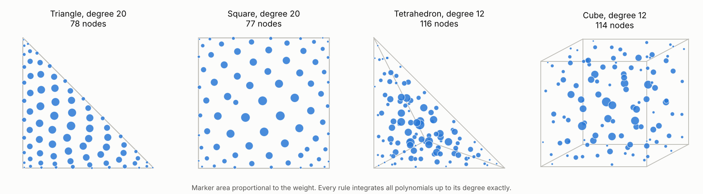
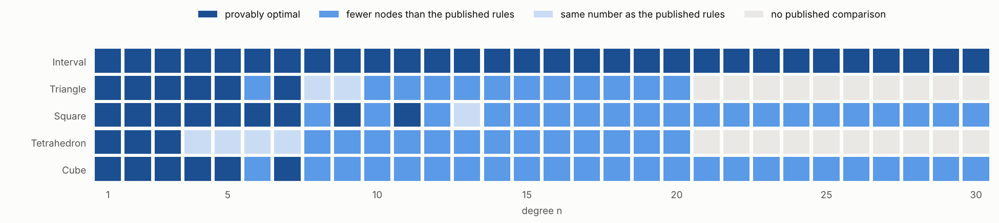
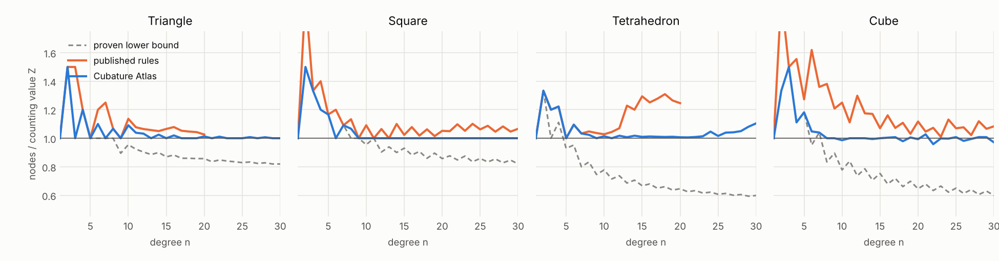
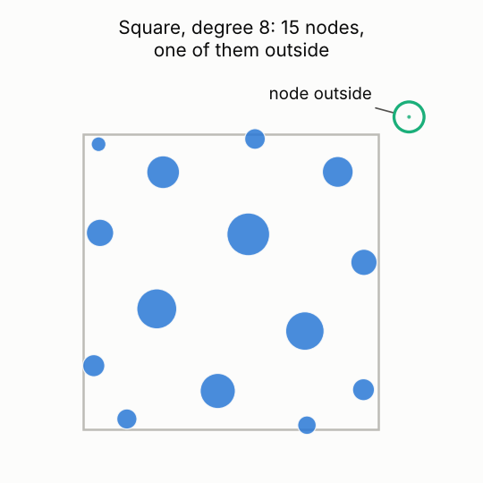

# Cubature Atlas

[](https://doi.org/10.5281/zenodo.24037245)

**How few points do you need to integrate a polynomial exactly?** The Cubature Atlas collects the answers for the interval, triangle, square, tetrahedron and cube, for every degree from 1 to 30. Every rule has positive weights, and **every rule comes with a computer-assisted proof**.

**→ Explore it on the website: <https://jukzi.github.io/cubature_atlas/>** (interactive viewer, tables, charts, downloads)

<picture>
  <source media="(prefers-color-scheme: dark)" srcset="assets/readme_gallery_dark.png">
  
</picture>

## The idea in one picture

A cubature rule replaces an integral by a weighted sum over a few points:

∫ f(x) dx ≈ w₁ f(x₁) + w₂ f(x₂) + … + w_N f(x_N)

A rule of **degree n** gets this exactly right for every polynomial up to degree n. Fewer points means less work every time the rule is used, which is why finite-element codes, simulations and numerical libraries care about rules that are as small as possible.

<p align="center">
  <a href="https://jukzi.github.io/cubature_atlas/"></a>
  <br>
  <sub>Two points are enough for every cubic on an interval: the bars (width = weight, height = value at the node) always enclose the same area as the curve.</sub>
</p>

In one dimension the answer has been known since Gauss. On triangles, squares, tetrahedra and cubes it is a hard, mostly open search problem, and the published tables stop at moderate degrees.

## What makes this atlas different

**Complete.** All 5 domains × 30 degrees = 150 cells are filled, with over 300 rules in total.

**Proven, not just computed.** Floating-point searches can be wrong in the last digits, or worse. Here every rule is checked with interval arithmetic: the proof shows that an *exact* rule, with positive weights and with its nodes where the file says they are, exists within about 10<sup>-10</sup> of the stored numbers (`tools/verify_rigorous.py`). A rule without such a proof is not accepted.

**Smaller than the published rules, and never larger.** In 100 of the 150 cells there is a published rule to compare with (Xiao–Gimbutas, and the fully symmetric rules of Witherden–Vincent, Jaśkowiec–Sukumar and Diallo–Worku). The atlas matches it everywhere and **needs fewer nodes in 78 of these cells**: for example, degree 20 on the tetrahedron takes 446 nodes instead of 552.

**Often provably optimal.** In **54 cells** the number of nodes equals a proven lower bound, so no rule with positive weights can do better.

<picture>
  <source media="(prefers-color-scheme: dark)" srcset="assets/readme_map_dark.png">
  
</picture>

### How close to the limit?

A natural yardstick is the **counting value Z**: the number of equations divided by the unknowns per node. A rule with fewer than Z nodes is only possible thanks to special structure such as symmetry. From degree 8 on, the atlas stays within about 10 % of Z, mostly within 1–2 %, and on the cube it even goes *below* Z in ten cells. The published rules (orange) are typically 5–30 % above it; the proven lower bound (dashed) shows how much room theory still leaves.

<picture>
  <source media="(prefers-color-scheme: dark)" srcset="assets/readme_efficiency_dark.png">
  
</picture>

| Degree 20 | Atlas | best published | tensor-product Gauss |
|---|---:|---:|---:|
| Triangle | 78 | 79 | 121 |
| Square | 77 | 81 | 121 |
| Tetrahedron | 446 | 552 | 1331 |
| Cube | 440 | 495 | 1331 |

### Sometimes the best rule steps outside

<picture>
  <source media="(prefers-color-scheme: dark)" srcset="assets/readme_outside_dark.png">
  
</picture>

Allowing nodes **outside** the domain (quality *PO*) saves nodes in 40 cells. The degree-8 square rule on the right needs only 15 nodes, but one of them sits just outside the square. With all nodes inside, the best known rule has 16 nodes. These rules are useful whenever the integrand is defined beyond the domain, and they are kept in their own family.

<br clear="right">

## Use a rule

Every rule is a small JSON file with nodes and weights; the website offers each one as a download (and all of them as a ZIP).

```python
import json, math

rule = json.load(open("rules/minimal_pointcount_for_degree_n_PI/triangle/CA-T2-20-78-PI-MPC.json"))
f = lambda x, y: math.exp(x) * math.cos(y)
approx = sum(w * f(x, y) for (x, y), w in zip(rule["nodes"], rule["weights"]))
print(approx)   # 0.668254268891508..., error about 4e-15 with 78 points
```

Domains: interval [−1,1], triangle (0,0),(1,0),(0,1), square [−1,1]<sup>2</sup>, tetrahedron (0,0,0),(1,0,0),(0,1,0),(0,0,1), cube [−1,1]<sup>3</sup>. The weights sum to the volume.

## Open questions

The atlas marks the places where the truth is not known yet. Three examples:

- **Triangle, degree 9:** is 19 nodes minimal? The proven lower bound is 17.
- **Cube, degree 6:** are 22 nodes inside (21 with nodes outside) minimal? The lower bound is 20.
- **Square, degree 8:** a 15-node rule inside the square would be optimal. Numerically, the only 15-node rules are the one shown above and its mirror images, with a node outside; an exact proof is still missing.

Ideas, better rules and proofs are welcome.

## How it was made

> **AI-generated.** The search, the computations, the proofs, the code and the texts were produced by an AI (Claude, Anthropic), commissioned and directed by Dr. rer. nat. Jörg Kubitz (Dipl.-Math.).

The rules come from numerical searches: symmetric orbit searches, node elimination from larger rules, cannonball-packing starts, and combinations of these (see [code/README.md](code/README.md)). Their results are accepted only after the interval proof. The website and the per-rule pages are generated from the rule files on every change.

## Contributing

Pull requests are welcome. [CONTRIBUTING.md](CONTRIBUTING.md) describes the workflow; [DEVELOPMENT.md](DEVELOPMENT.md) describes the rule files, the families, the checks and proofs, the automatic searches and the translations; [literature.md](literature.md) lists the literature used and tried.

## Citing

Please cite the atlas with its DOI and the rule by its id, e.g.

> Jörg Kubitz: *Cubature Atlas: best known quadrature and cubature rules with positive weights*. Zenodo. https://doi.org/10.5281/zenodo.24037245, rule CA-T2-13-35-PI-MPC.

The DOI 10.5281/zenodo.24037245 always resolves to the latest version. To cite one exact version, use its version DOI from Zenodo (v1.0.0: [10.5281/zenodo.24037246](https://doi.org/10.5281/zenodo.24037246)). See `CITATION.cff`. Rules taken from the literature must be cited with their original publication (given in the rule file and in `family.json`).

## License

Copyright © 2026 Jörg Kubitz. The Cubature Atlas (rules, data, texts, website and code) is licensed under the [Creative Commons Attribution 4.0 International License (CC BY 4.0)](https://creativecommons.org/licenses/by/4.0/), see `LICENSE`. You may use, share and adapt it for any purpose, including commercially, as long as you give appropriate credit (see *Citing*) and indicate if changes were made.

Exception: the rules in the literature families (`witherden_vincent_2015`, `jaskowiec_sukumar_2020`, `diallo_worku_2026`) are reproduced from the cited publications for comparison and are not covered by this license; their original terms apply.
